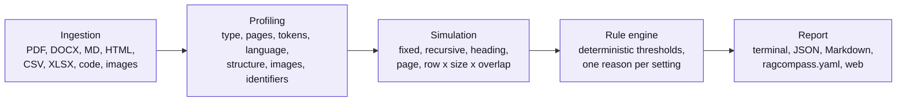

<p align="center">
  <picture>
    <source media="(prefers-color-scheme: dark)" srcset="docs/assets/wordmark-dark.svg">
    
  </picture>
</p>

<p align="center">
  <b>Point it at a document or a folder. Get a RAG configuration where every setting is backed by numbers measured on your files.</b>
</p>

<p align="center">
  
  
  
  
  
  
  
</p>

---

Most RAG setups start from defaults copied out of a tutorial: 512-token chunks, 10% overlap, top-k 5. Those numbers say
nothing about *your* documents. A corpus of scanned invoices, a product catalogue full of SKUs and a wiki with deep
heading trees each need a different pipeline.

**ragcompass** parses the corpus, profiles every file, actually chunks it with several strategies and sizes, measures
what each one breaks, and then runs a deterministic rule engine that turns those measurements into a configuration.
Each recommendation comes with the reason and the figures behind it. No API keys are needed and nothing leaves your
machine.

<p align="center">
  
</p>

## What it recommends

| Setting | Decided from |
|---|---|
| **Parser** per file type: text layer, OCR or vision model | Characters per page, page-wide images, figures per page |
| **Chunking strategy, size and overlap** per content group (documents, tables, code) | The simulation below, section lengths, row lengths |
| **Number of vectors and index size** at 384 / 768 / 1024 / 1536 / 3072 dims, float32 vs int8, HNSW graph | Simulated chunk counts, images, scanned pages |
| **Embedding dimension, models and cost** | Language mix and tokens to embed, overlap and image captions included |
| **Top-k, hybrid BM25, reranker** | Context budget, largest chunk size, identifier density, index size |
| **Metadata to store** | Pages, headings, sheets, languages, date density |

The output is a terminal report, JSON, Markdown, and a `ragcompass.yaml` you can feed into your ingestion code
([sample](examples/ragcompass.yaml), [full report](examples/report.md)).

## Web app

Upload files or a whole folder (drag and drop keeps the folder structure), read the report, download the YAML.
Light and dark themes, English and Spanish.

<p align="center">
  <picture>
    <source media="(prefers-color-scheme: dark)" srcset="docs/assets/web-report-dark.png">
    
  </picture>
</p>

<p align="center">
  <picture>
    <source media="(prefers-color-scheme: dark)" srcset="docs/assets/web-simulation-dark.png">
    
  </picture>
</p>

## Pipeline



1. **Ingestion.** Every file becomes a list of structural blocks (heading, paragraph, list item, table, code) in reading
   order. PDFs use PyMuPDF: headings come from font size, tables from ruled-table detection, and a page with almost no
   text under a page-wide image is flagged as a scan.
2. **Profiling.** Pages, tokens (tiktoken `cl100k_base`, with a deterministic offline fallback), language (stopword
   profile, offline), headings, tables, lists, images per page and identifier density: codes such as `RLY-4471-B`,
   dates and numbers per 1,000 tokens.
3. **Simulation.** Each content group is chunked with every applicable strategy at 256, 512 and 1024 tokens and 0, 10
   and 20% overlap. Every chunk boundary is classified against the canonical text.
4. **Rules.** Thresholds live in one file ([`rules.py`](src/ragcompass/rules.py)) next to the reason they exist. The
   same input always yields the same output, and a test checks it.
5. **Report.** CLI, API and web share one `Report` model.

### What the simulation measures

| Metric | A chunk counts when... |
|---|---|
| Sentence cuts | one of its boundaries falls inside a sentence |
| Table cuts | a boundary splits a table row, or it holds rows without their header |
| Orphan headings | it ends on a heading, so the title is separated from its section |
| Code cuts | a boundary falls mid-line, inside an indented block, between a decorator and its function, or after an open statement |
| Tiny | it is smaller than a quarter of the target size |

`damage = sentence cuts + 3 x table cuts + orphan headings + code cuts + tiny`, all in % of chunks. Table cuts weigh triple because
a row without its column names is unreadable for both the retriever and the generator.

On the sample corpus, fixed 256-token windows cut a sentence in 82% of chunks and split a table in 36%. Recursive
splitting fixes the sentences but leaves 25% of chunks ending on an orphan heading. Heading-aware packing gets all three
to zero.

## Rules and their rationale

| Rule | Threshold | Why |
|---|---|---|
| Scanned page | Images cover >= 50% of the page (strips of a split scan are added up) and the text layer has < 25 characters or text boxes under 5% of the image area | There is no usable text layer; a stamp or page number printed on a scan does not make it searchable. Blank pages are ignored. Scanned pages are not simulated: they are estimated at 800 tokens/page (a dense A4 page of 500-600 words) and reported as an estimate. |
| VLM for figures | >= 0.5 figures per page | Diagrams and charts carry content that text extraction drops. |
| Structure-aware candidates | heading / page strategies compete only if >= 50% of the group's tokens have that structure | Otherwise they fall back to recursive splitting and the comparison is meaningless. |
| Chunk size, structured text | Smallest of 256 / 512 / 1024 that fits the median section | Keeps most sections whole, so a chunk answers one question. |
| Chunk size, unstructured text | 512, or 256 if >= 3 codes per 1k tokens | 512 is a balanced default; lookup-heavy text needs one fact per vector. |
| Chunk size, tables | Smallest size that fits the header plus 8 median rows | Enough rows for range questions without mixing far-apart records. |
| Strategy | Lowest damage at the chosen size; ties prefer heading > row > page > recursive > fixed | Measured, not assumed; ties go to the strategy that preserves more structure. |
| Overlap | 0 if no sentence cuts, 10% below 15% cuts, 20% above; always 0 for heading, page and row | Overlap only pays for itself when boundaries break sentences, and it costs extra tokens (reported). |
| Hybrid BM25 | >= 3 codes or >= 25 identifiers per 1k tokens | Dense embeddings split SKUs and part numbers into sub-word pieces and match them poorly; BM25 matches them exactly. 3 codes per 1k tokens is about one per 256-token chunk; 25 identifiers per 1k is one every ~40 tokens, typical of spec sheets and price lists. Quantities with units (220V, 10mm, M8x20), ordinals and names such as utf-8 are not counted as codes. Undecided when there is no text. |
| Embedding dimension | Undecided when no language can be detected (for example, a corpus of scans): decide after OCR. Otherwise 1024 multilingual (bge-m3, multilingual-e5-large) if any second language holds >= 10% of tokens or the text is not English; otherwise 768 (nomic-embed-text, bge-base-en-v1.5) | Multilingual retrieval needs a multilingual model; English-only text gets strong recall at half the storage of 1536. |
| Quantization | int8 when the float32 index plus HNSW graph exceeds 1 GiB | 1 GiB fits a small instance; above it memory drives the cost and int8 cuts vectors 4x for a small recall loss. Below it, quantization trades recall for memory you do not need to save. |
| Index size | `vectors x dim x 4` (float32), `x 1` (int8), plus `vectors x 2M x 4` bytes of HNSW links with M = 16 | Plain arithmetic, shown for every common dimension. |
| Top-k | `3000 // largest chunk size` across groups, at most 10 and never more than the vectors in the index | Fills a 3,000-token context budget without overflowing it, whichever group the chunks come from. |
| Reranker | >= 10,000 vectors; then retrieve 4 x top-k candidates (capped at the index size) | Below that a top-k is a meaningful slice of the index; above it the first page of dense results fills with near-miss neighbours, which a cross-encoder reorders. Each candidate costs one model call, so it is not recommended by default on small indexes. |
| Metadata | `source`, `chunk_index` always; `page`, `heading_path`, `sheet`, `row_range`, `language`, `dates`, `doc_kind` when the corpus has them | Citations, neighbour expansion and filters need these at query time; they cannot be recovered later. |

## Quickstart

Requires [uv](https://docs.astral.sh/uv/). No API keys.

```bash
uv sync
uv run ragcompass analyze examples/corpus            # terminal report
uv run ragcompass analyze examples/corpus --md       # Markdown
uv run ragcompass analyze examples/corpus --json     # full report, all simulations included
uv run ragcompass analyze ./my-docs -o ragcompass.yaml
uv run ragcompass analyze ./my-docs --all            # every simulated configuration
```

Web app and API in one container, on <http://localhost:8460>:

```bash
docker compose up --build
```

Or run them separately for development:

```bash
uv run ragcompass serve                 # API on :8460
cd web && npm install && npm run dev    # web on :5460, proxies /api
```

| Endpoint | Purpose |
|---|---|
| `POST /api/analyze?format=json\|md\|yaml` | Multipart upload of files; folder uploads keep relative paths |
| `POST /api/sample` | Analyse the bundled sample corpus |
| `POST /api/render?format=md\|yaml` | Render a report the client already has |
| `GET /api/health` | Health check |

**Optional LLM summary.** `--llm-summary` (or `?llm_summary=true`) asks a local [Ollama](https://ollama.com) model
(`OLLAMA_HOST`, `RAGCOMPASS_OLLAMA_MODEL`, default `llama3.2`) to explain the report in plain language. It is off by
default and never changes a recommendation.

**Tokenizer.** `cl100k_base` is the encoding used by OpenAI's embedding models and a close proxy for others. Without
network access and without a cached encoding, ragcompass falls back to a regex word tokenizer and says so in the report.
The Docker image ships the encoding pre-cached. `--tokenizer regex` forces the fallback.

## Validate your config

ragcompass predicts which configuration will damage your text least; it does not measure retrieval quality. To check
that the recommended configuration actually retrieves better than the alternative, build the index both ways and
compare them on a labelled query set with
[**evalsmith-mcp**](https://github.com/diegoperezg7/evalsmith-mcp): `compare_configs` reports recall@k, MRR and nDCG
with bootstrap intervals, and `evalsmith run evalsmith.yaml --fail-under recall@5=0.8` fails CI when a change makes
retrieval worse.

## Tests

```bash
uv run pytest
uv run ruff check .
```

The suite checks the chunkers on inputs small enough to count by hand (for example, a 10-token text in windows of 4
with overlap 1 gives exactly `a b c d`, `d e f g`, `g h i j`). It also checks extracted structure against the content
written into the sample corpus: 8 headings, 2 tables with 5 and 7 rows and 8 list items in the manual PDF, and a single
page with no text layer in the scanned invoice. Other tests cover the rule thresholds, the index-size arithmetic,
determinism, the API (including path traversal in uploads) and the CLI.

## Sample corpus

[`examples/corpus`](examples) is synthetic and written for this repository (CC0): a maintenance manual (text PDF), a
scanned invoice (image-only PDF), a Spanish returns policy (DOCX), an onboarding handbook (Markdown), an FAQ page
(HTML), a product catalogue (CSV), a two-sheet stock workbook (XLSX), a Python script and a diagram (PNG).
`uv run python examples/generate.py` rebuilds it.

## Repository layout

```
ragcompass/
├── src/ragcompass/
│   ├── ingest/          # pdf, docx, html, tabular (csv/xlsx), text (md/txt/code)
│   ├── layout.py        # canonical text + block spans; boundary classification
│   ├── tokens.py        # tiktoken with offline regex fallback
│   ├── signals.py       # language detection, identifier density
│   ├── profile.py       # per-document profile
│   ├── chunking.py      # fixed, recursive, heading, page, row
│   ├── simulate.py      # strategy x size x overlap grid and metrics
│   ├── rules.py         # deterministic rule engine and thresholds
│   ├── analyze.py       # pipeline entry point
│   ├── report.py        # terminal, JSON, Markdown, YAML renderers
│   ├── cli.py           # Typer CLI
│   ├── api.py           # FastAPI app, serves the built web app
│   └── llm.py           # optional Ollama summary
├── web/                 # React + Vite + TypeScript + Zustand
├── tests/
├── examples/            # sample corpus, generator, sample outputs
├── docs/                # README assets and the CLI recording script
├── Dockerfile
└── docker-compose.yml
```

## License

Copyright (c) 2026 Diego Pérez. All rights reserved. The source is available for evaluation only; see
[LICENSE](LICENSE). The sample corpus in `examples/corpus` is CC0.
