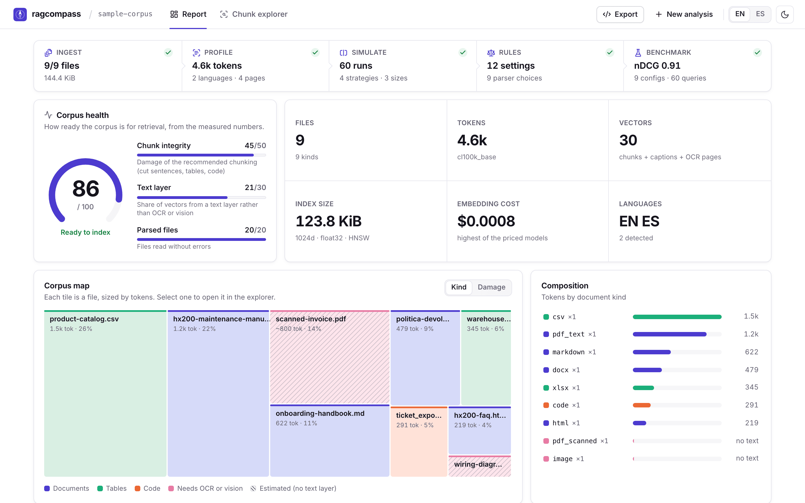
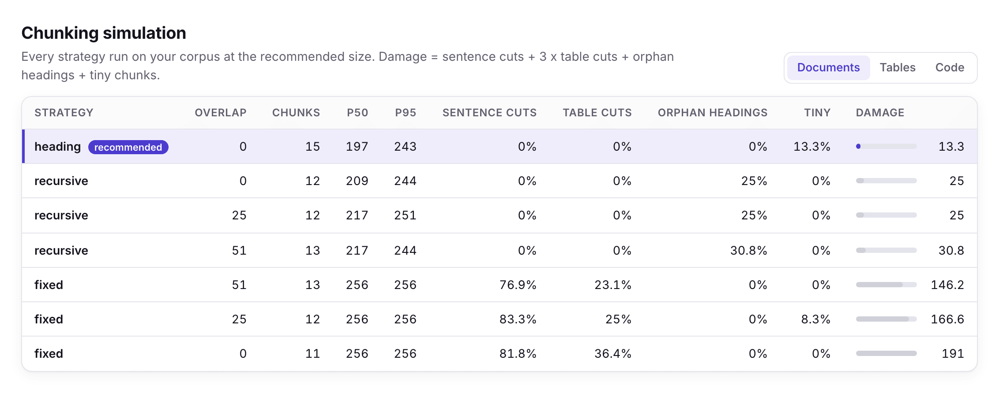

<p align="center">
  <picture>
    <source media="(prefers-color-scheme: dark)" srcset="docs/assets/wordmark-dark.svg">
    
  </picture>
</p>

<p align="center">
  <b>Point it at a document or a folder. Get a RAG configuration where every setting is backed by numbers measured on your files.</b>
</p>

<p align="center">
  
  
  
  
  
  
  
</p>

---

Most RAG setups start from defaults copied out of a tutorial: 512-token chunks, 10% overlap, top-k 5. Those numbers say
nothing about *your* documents. A corpus of scanned invoices, a product catalogue full of SKUs and a wiki with deep
heading trees each need a different pipeline.

**ragcompass** parses the corpus, profiles every file, actually chunks it with several strategies and sizes, measures
what each one breaks, and runs a deterministic rule engine that turns those measurements into a configuration. Then
`ragcompass bench` indexes the best candidates with BM25, local dense embeddings and hybrid search, scores them on
seeded queries with bootstrap intervals, and lets the measurement overrule a rule when they disagree. Each
recommendation states its reason, its figures and whether it is rule-based or measured. No API keys are needed and
nothing leaves your machine.

<p align="center">
  
</p>

## Four interfaces, one core

| Interface | Entry point | For | What it gives you |
|---|---|---|---|
| **CLI** | `ragcompass analyze`, `bench`, `export` | Terminals and CI | Rich report, JSON, Markdown, `ragcompass.yaml`, framework snippets, an evalsmith suite |
| **Web app** | `docker compose up`, <http://localhost:8460> | Exploring a corpus | Upload files or a folder, read the report, explore chunks, run the benchmark |
| **HTTP API** | `ragcompass serve`, [docs/api.md](docs/api.md) | Other services, the web app | Reports kept by id, chunk explorer, benchmark, 2D embedding projection, exports |
| **MCP server** | `ragcompass mcp` (stdio or Streamable HTTP) | Assistants and agents | `analyze_corpus`, `recommend_config`, `run_benchmark`, `export_config` |

## What it recommends

| Setting | Decided from |
|---|---|
| **Parser** per file type: text layer, OCR or vision model | Characters per page, page-wide images, figures per page |
| **Chunking strategy, size and overlap** per content group (documents, tables, code) | The simulation below, section lengths, row lengths |
| **Number of vectors and index size** at 384 / 768 / 1024 / 1536 / 3072 dims, float32 vs int8, HNSW graph | Simulated chunk counts, images, scanned pages |
| **Embedding dimension, models and cost** | Language mix and tokens to embed, overlap and image captions included |
| **Retriever** (BM25, dense or hybrid), **top-k**, **reranker** | Identifier density, context budget, largest chunk size, index size; the benchmark when it runs |
| **Metadata to store** | Pages, headings, sheets, languages, date density |

The output is a terminal report, JSON, Markdown, a `ragcompass.yaml` you can feed into your ingestion code and
ready-to-paste LangChain, LlamaIndex or Haystack code ([sample yaml](examples/ragcompass.yaml),
[report](examples/report.md), [report with benchmark](examples/bench-report.md)). Reasons are stored as message ids with
their parameters and rendered in English or Spanish; the JSON carries the ids, the parameters and the text in both
languages.

## Web app

Upload files or a whole folder (drag and drop keeps the folder structure), read the report, download the YAML.
Light and dark themes, English and Spanish.

<p align="center">
  <picture>
    <source media="(prefers-color-scheme: dark)" srcset="docs/assets/web-report-dark.png">
    
  </picture>
</p>

<p align="center">
  <picture>
    <source media="(prefers-color-scheme: dark)" srcset="docs/assets/web-simulation-dark.png">
    
  </picture>
</p>

## Pipeline

```mermaid
flowchart LR
    A[Ingestion<br/>PDF, DOCX, MD, HTML,<br/>CSV, XLSX, code, images] --> B[Profiling<br/>type, pages, tokens, language,<br/>structure, images, identifiers]
    B --> C[Simulation<br/>fixed, recursive, heading,<br/>page, row x size x overlap]
    C --> D[Rule engine<br/>deterministic thresholds,<br/>one reason per setting]
    D --> E[Report<br/>rule-based or measured,<br/>English and Spanish]
    C -. candidates by damage .-> F[Benchmark<br/>seeded queries, BM25,<br/>dense, hybrid, bootstrap CI]
    F -. measured values .-> D
    E --> G[CLI, web, HTTP API, MCP<br/>ragcompass.yaml, framework code,<br/>evalsmith suite]

    classDef stage fill:#EFEDFC,stroke:#4C3BCF,color:#15141C
    classDef measure fill:#FFFFFF,stroke:#4C3BCF,color:#15141C,stroke-dasharray: 4 3
    class A,B,C,D,E,G stage
    class F measure
```



1. **Ingestion.** Every file becomes a list of structural blocks (heading, paragraph, list item, table, code) in reading
   order. PDFs use PyMuPDF: headings come from font size, tables from ruled-table detection, and a page with almost no
   text under a page-wide image is flagged as a scan.
2. **Profiling.** Pages, tokens (tiktoken `cl100k_base`, with a deterministic offline fallback), language (stopword
   profile, offline), headings, tables, lists, images per page and identifier density: codes such as `RLY-4471-B`,
   dates and numbers per 1,000 tokens.
3. **Simulation.** Each content group is chunked with every applicable strategy at 256, 512 and 1024 tokens and 0, 10
   and 20% overlap. Every chunk boundary is classified against the canonical text.
4. **Rules.** Thresholds live in one file ([`rules.py`](src/ragcompass/rules.py)) next to the reason they exist. The
   same input always yields the same output, and a test checks it.
5. **Benchmark** (optional). The recommended chunking and the next candidates by damage are indexed and scored on
   generated queries; significant results replace the rule-based chunking, retriever and top-k (see below).
6. **Report.** CLI, API, web and MCP share one `Report` model. Reasons are message ids with parameters, rendered in
   English or Spanish.

### What the simulation measures

| Metric | A chunk counts when... |
|---|---|
| Sentence cuts | one of its boundaries falls inside a sentence |
| Table cuts | a boundary splits a table row, or it holds rows without their header |
| Orphan headings | it ends on a heading, so the title is separated from its section |
| Code cuts | a boundary falls mid-line, inside an indented block, between a decorator and its function, or after an open statement |
| Tiny | it is smaller than a quarter of the target size |

`damage = sentence cuts + 3 x table cuts + orphan headings + code cuts + tiny`, all in % of chunks. Table cuts weigh triple because
a row without its column names is unreadable for both the retriever and the generator.

On the sample corpus, fixed 256-token windows cut a sentence in 82% of chunks and split a table in 36%. Recursive
splitting fixes the sentences but leaves 25% of chunks ending on an orphan heading. Heading-aware packing gets all three
to zero.

## Rules and their rationale

| Rule | Threshold | Why |
|---|---|---|
| Scanned page | Images cover >= 50% of the page (strips of a split scan are added up) and the text layer has < 25 characters or text boxes under 5% of the image area | There is no usable text layer; a stamp or page number printed on a scan does not make it searchable. Blank pages are ignored. Scanned pages are not simulated: they are estimated at 800 tokens/page (a dense A4 page of 500-600 words) and reported as an estimate. |
| VLM for figures | >= 0.5 figures per page | Diagrams and charts carry content that text extraction drops. |
| Structure-aware candidates | heading / page strategies compete only if >= 50% of the group's tokens have that structure | Otherwise they fall back to recursive splitting and the comparison is meaningless. |
| Chunk size, structured text | Smallest of 256 / 512 / 1024 that fits the median section | Keeps most sections whole, so a chunk answers one question. |
| Chunk size, unstructured text | 512, or 256 if >= 3 codes per 1k tokens | 512 is a balanced default; lookup-heavy text needs one fact per vector. |
| Chunk size, tables | Smallest size that fits the header plus 8 median rows | Enough rows for range questions without mixing far-apart records. |
| Strategy | Lowest damage at the chosen size; ties prefer heading > row > page > recursive > fixed | Measured, not assumed; ties go to the strategy that preserves more structure. |
| Overlap | 0 if no sentence cuts, 10% below 15% cuts, 20% above; always 0 for heading, page and row | Overlap only pays for itself when boundaries break sentences, and it costs extra tokens (reported). |
| Hybrid BM25 | >= 3 codes or >= 25 identifiers per 1k tokens | Dense embeddings split SKUs and part numbers into sub-word pieces and match them poorly; BM25 matches them exactly. 3 codes per 1k tokens is about one per 256-token chunk; 25 identifiers per 1k is one every ~40 tokens, typical of spec sheets and price lists. Quantities with units (220V, 10mm, M8x20), ordinals and names such as utf-8 are not counted as codes. Undecided when there is no text. |
| Embedding dimension | Undecided when no language can be detected (for example, a corpus of scans): decide after OCR. Otherwise 1024 multilingual (bge-m3, multilingual-e5-large) if any second language holds >= 10% of tokens or the text is not English; otherwise 768 (nomic-embed-text, bge-base-en-v1.5) | Multilingual retrieval needs a multilingual model; English-only text gets strong recall at half the storage of 1536. |
| Quantization | int8 when the float32 index plus HNSW graph exceeds 1 GiB | 1 GiB fits a small instance; above it memory drives the cost and int8 cuts vectors 4x for a small recall loss. Below it, quantization trades recall for memory you do not need to save. |
| Index size | `vectors x dim x 4` (float32), `x 1` (int8), plus `vectors x 2M x 4` bytes of HNSW links with M = 16 | Plain arithmetic, shown for every common dimension. |
| Top-k | `3000 // largest chunk size` across groups, at most 10 and never more than the vectors in the index | Fills a 3,000-token context budget without overflowing it, whichever group the chunks come from. |
| Reranker | >= 10,000 vectors; then retrieve 4 x top-k candidates (capped at the index size) | Below that a top-k is a meaningful slice of the index; above it the first page of dense results fills with near-miss neighbours, which a cross-encoder reorders. Each candidate costs one model call, so it is not recommended by default on small indexes. |
| Metadata | `source`, `chunk_index` always; `page`, `heading_path`, `sheet`, `row_range`, `language`, `dates`, `doc_kind` when the corpus has them | Citations, neighbour expansion and filters need these at query time; they cannot be recovered later. |

## Benchmark: measured, not assumed

```bash
uv sync --extra bench                                   # local dense embeddings (fastembed, ONNX)
uv run ragcompass bench examples/corpus                 # 60 seeded queries
uv run ragcompass bench ./my-docs --queries-file my-questions.jsonl --export-evalsmith evals/
```

How it works:

- **Queries** are drawn with a fixed seed from source sentences and table rows, in three kinds: keyphrases,
  masked keyphrases without their rarest words (codes and numbers first) and masked questions. The ground truth is
  the character span of the source, and a retrieved chunk is relevant when it overlaps it, so chunkings of different
  shapes are judged on the same targets.
- **Candidates**: the recommended chunking, the best configuration of another strategy and the next one by damage.
- **Retrievers**: Okapi BM25, dense retrieval with a local model (`BAAI/bge-small-en-v1.5` for English,
  `paraphrase-multilingual-MiniLM-L12-v2` otherwise; `RAGCOMPASS_DENSE_MODEL` overrides) and hybrid by reciprocal
  rank fusion. Small models read 128 or 512 tokens per pass, so longer chunks are split into windows with the model's
  own tokenizer and the window vectors are averaged; the report counts how many. Without the extra, BM25 only.
- **Metrics**, each with a 95% paired bootstrap interval: span recall@k (share of the source span covered by the
  top-k); recall within 1,024 tokens of context (ranked chunks are kept only while they fit, which charges big
  chunks for the room they take); MRR; and nDCG@k whose gain is the share of the span a chunk newly covers, so a
  duplicate neither helps nor hurts and a first chunk that contains the whole span scores 1. Latency: index time
  after a warm-up and without cache, and per-query time including the query embedding, the same for every
  configuration.
- **Decisions** use Bonferroni-adjusted intervals for the number of comparisons made:
  - *Chunking* is decided on recall within the token budget, so a configuration cannot win by being bigger, and with
    the retriever that will be deployed (the comparison is repeated if the measured retriever differs from the rule's). A
    candidate replaces the rule only when its lead over the rule's pick excludes zero; otherwise the setting stays
    rule-based.
  - *Retriever* compares BM25, dense and hybrid on nDCG@k. An option that loses significantly to the best is never
    returned; among options within noise of the best, the rule's choice stands, and hybrid is preferred to a tied
    single retriever. When the queries copy 60% or more of their words from their source, BM25 alone is not
    eligible, because it wins by construction.
  - *Top-k* becomes the smallest k whose recall reaches 95% of recall@10, up or down from the rule; the report says
    when that exceeds the context budget, and nothing is decided when recall@10 is 0.
  - Every reason states the k it was measured at.
- **Limits**: dense indexing is skipped above 20,000 chunks per configuration, and a run stops with a clear error
  after `RAGCOMPASS_BENCH_TIMEOUT` seconds (600 by default).

On the sample corpus ([full output](examples/bench-report.md)):

| Configuration | Chunks | Recall@5 | Recall@1024 tok | nDCG@5 |
|---|---|---|---|---|
| recursive 1024/102 · hybrid | 11 | 1.0 [1.0, 1.0] | 0.867 [0.783, 0.95] | 0.92 [0.876, 0.959] |
| heading 512/0 · bm25 | 13 | 1.0 [1.0, 1.0] | 0.95 [0.883, 1.0] | 0.912 [0.867, 0.951] |
| heading 256/0 · bm25 (rule-based pick) | 21 | 1.0 [1.0, 1.0] | 0.95 [0.883, 1.0] | 0.907 [0.864, 0.949] |
| heading 256/0 · hybrid | 21 | 1.0 [1.0, 1.0] | 0.95 [0.9, 1.0] | 0.877 [0.823, 0.929] |
| heading 256/0 · dense | 21 | 0.867 [0.783, 0.95] | 0.733 [0.617, 0.833] | 0.628 [0.539, 0.708] |

- **Chunking** stays heading 256/0, rule-based: the 1,024-token chunks top nDCG@5 because each chunk holds more of
  the corpus, but within the same context budget they recover less of the span (0.867 against 0.95), and no
  candidate's lead survives the adjusted intervals.
- **Retriever** stays hybrid, now measured: bm25 0.907, dense 0.628, hybrid 0.877. BM25 alone scores highest, but
  the queries copy 83% of their words from their source, so BM25 is not eligible on this evidence; hybrid beats dense
  with an interval that excludes zero.
- **Top-k** goes from 5 to 3: recall@3 already reaches 95% of recall@10 with hybrid.

The report separates the recommendation (heading 256/0 · hybrid, top-k 3, each part labelled rule-based or
measured) from the configuration with the highest nDCG@5 (recursive 1024/102 · hybrid), so a higher score that the
decisions rejected is never presented as the winner. Chunkings are compared with the retriever that will be
deployed.

**Read these numbers with care.** Synthetic queries are an approximation of real ones: even masked, they reuse the
words of their source (83% here), which favours BM25; the report says so and the decisions account for it. The
dense model is a small multilingual one that reads 128 tokens at a time, and 60 queries over a nine-file corpus give
wide intervals. `--queries llm` asks a local Ollama model for paraphrased questions, and `--queries-file` takes
questions from your users, which is the measure to trust:

```json
{"text": "how do I open the back cover?", "answer": "Remove the four screws of the rear grille with a T10 driver.", "file": "hx200-maintenance-manual.pdf"}
```

One JSON object per line (or a JSON list). `answer` is a passage copied from the document and becomes the
ground-truth span; `file` and `id` are optional.

## Export to your framework

```bash
uv run ragcompass export ./my-docs --target langchain     # or llamaindex, haystack, yaml
uv run ragcompass export ./my-docs --target haystack --bench -o rag.py   # measured values
```

The snippet defines `split(documents)` and `make_retriever(...)` with the recommended splitter, size, overlap,
retriever and top-k, imports only what that setup needs, and wires local Ollama embeddings in its `__main__` block.
Every combination of framework, strategy and retriever is parsed in the tests, and every import is checked against
the `pip install` line of the snippet; the heading, recursive and fixed splitters with each retriever also run
against the real libraries (tested with LangChain 1.4, LlamaIndex 0.14 and Haystack 3.4)
with fake embeddings.

## MCP server

```bash
uv run ragcompass mcp --root ~/documents                       # stdio
uv run ragcompass mcp --transport http --port 8461 --root ~/documents   # Streamable HTTP, stateless
```

| Tool | Arguments | Returns |
|---|---|---|
| `analyze_corpus` | `path`, `lang` | Summary, per-file profiles, the chosen chunking simulations and every recommendation with its reason |
| `recommend_config` | `path`, `lang` | The `ragcompass.yaml` configuration and the reasons |
| `run_benchmark` | `path`, `queries`, `seed`, `k`, `dense`, `lang` | Benchmark results with intervals, decisions and the updated configuration |
| `export_config` | `path`, `target`, `measured` | `ragcompass.yaml` or framework code |

The HTTP transport listens on 127.0.0.1 by default and warns when bound to another address: it has no
authentication. Tools only read paths under the allowed roots (`--root`, repeatable, or `RAGCOMPASS_MCP_ROOTS`; the working directory
by default) and reuse an analysis until the files change. Built on the official Python SDK; the tests drive it in
memory, over stdio and over HTTP. Client configuration: [`examples/mcp-client-config.json`](examples/mcp-client-config.json).

## Quickstart

Requires [uv](https://docs.astral.sh/uv/). No API keys.

```bash
uv sync                                             # add --extra bench for dense retrieval
uv run ragcompass analyze examples/corpus            # terminal report
uv run ragcompass analyze examples/corpus --md       # Markdown
uv run ragcompass analyze examples/corpus --json     # full report, all simulations included
uv run ragcompass analyze ./my-docs -o ragcompass.yaml
uv run ragcompass analyze ./my-docs --all            # every simulated configuration
uv run ragcompass analyze ./my-docs --lang es        # reasons and labels in Spanish
```

Web app and API in one container, on <http://localhost:8460> (the image includes the bench extra; embedding models
are downloaded on first use into the `models` volume):

```bash
docker compose up --build
```

The API and the MCP server have no authentication. Keep them on localhost or put them behind a reverse proxy that
authenticates; do not expose the container port to the internet as is.

Or run them separately for development:

```bash
uv run ragcompass serve                 # API on :8460
cd web && npm install && npm run dev    # web on :5460, proxies /api
```

| Endpoint | Purpose |
|---|---|
| `POST /api/analyze?format=json\|md\|yaml&lang=en\|es` | Multipart upload of files; folder uploads keep relative paths; bodies over 50 MB are rejected while they stream in |
| `POST /api/sample` | Analyse the bundled sample corpus |
| `GET /api/report/{id}` | A report kept in memory (30 minutes, 32 reports) |
| `GET /api/report/{id}/chunks?file=&strategy=&size=&overlap=` | One file's text with every chunk's span, size and issues |
| `POST` / `GET /api/report/{id}/bench` | Run the benchmark / read its result |
| `GET /api/report/{id}/projection` | 2D PCA map of chunk embeddings, with the queries and their nearest chunks |
| `GET /api/report/{id}/export?target=` | `ragcompass.yaml` or framework code |
| `POST /api/render?format=md\|yaml` | Render a report the client already has |
| `GET /api/health` | Health check |

The full contract, with every field, is in [docs/api.md](docs/api.md).

**Optional LLM summary.** `--llm-summary` (or `?llm_summary=true`) asks a local [Ollama](https://ollama.com) model
(`OLLAMA_HOST`, `RAGCOMPASS_OLLAMA_MODEL`, default `llama3.2`) to explain the report in plain language. It is off by
default and never changes a recommendation.

**Tokenizer.** `cl100k_base` is the encoding used by OpenAI's embedding models and a close proxy for others. Without
network access and without a cached encoding, ragcompass falls back to a regex word tokenizer and says so in the report.
The Docker image ships the encoding pre-cached. `--tokenizer regex` forces the fallback.

## Validate your config

`ragcompass bench --export-evalsmith evals/` writes the queries, per-chunking qrels, one run per retriever and an
`evalsmith.yaml` for [**evalsmith-mcp**](https://github.com/diegoperezg7/evalsmith-mcp), with gates 0.05 below the
measured recall@k and nDCG@k:

```bash
npx evalsmith run evals/evalsmith.yaml      # passes today, fails the build when retrieval regresses
```

Chunk ids differ between chunkings, so each chunking gets its own qrels (grade 2 when a chunk covers at least half
of the source span, 1 otherwise) and the suite compares the retrievers of the chosen one. On the sample corpus
([`examples/evalsmith`](examples/evalsmith)) evalsmith passes the suite with MRR 0.836, the same as ragcompass, and
nDCG@5 0.877 from the graded qrels, which here equals ragcompass's coverage-based 0.877. Replace the generated queries with your own
(`--queries-file`) to gate on questions your users ask.

## Tests

```bash
uv run pytest
uv run ruff check .
```

The suite checks the chunkers on inputs small enough to count by hand (for example, a 10-token text in windows of 4
with overlap 1 gives exactly `a b c d`, `d e f g`, `g h i j`). It also checks extracted structure against the content
written into the sample corpus: 8 headings, 2 tables with 5 and 7 rows and 8 list items in the manual PDF, and a single
page with no text layer in the scanned invoice. Other tests cover the rule thresholds, the index-size arithmetic,
determinism, code chunking, scan detection, encodings, translations (every message exists in both languages with
the same parameters), the API (path traversal, conflicting paths, body limits, a slow analysis not blocking
`/api/health`) and the CLI. Benchmark metrics are checked by hand on a three-chunk example, decisions on synthetic
scores, and the exported suite by running the real evalsmith CLI when it is available. The MCP server is tested in
memory, over stdio and over Streamable HTTP.

## Sample corpus

[`examples/corpus`](examples) is synthetic and written for this repository (CC0): a maintenance manual (text PDF), a
scanned invoice (image-only PDF), a Spanish returns policy (DOCX), an onboarding handbook (Markdown), an FAQ page
(HTML), a product catalogue (CSV), a two-sheet stock workbook (XLSX), a Python script and a diagram (PNG).
`uv run python examples/generate.py` rebuilds it.

## Repository layout

```
ragcompass/
├── src/ragcompass/
│   ├── ingest/          # pdf, docx, html, tabular (csv/xlsx), text (md/txt/code)
│   ├── layout.py        # canonical text + block spans; boundary classification
│   ├── tokens.py        # tiktoken with offline regex fallback
│   ├── signals.py       # language detection, identifier density
│   ├── profile.py       # per-document profile
│   ├── chunking.py      # fixed, recursive, heading, page, row
│   ├── simulate.py      # strategy x size x overlap grid and metrics
│   ├── rules.py         # deterministic rule engine and thresholds
│   ├── messages.py      # reason templates and labels in English and Spanish
│   ├── analyze.py       # pipeline entry point
│   ├── bench.py         # query generation, BM25, dense, RRF, metrics, bootstrap, evalsmith export
│   ├── embeddings.py    # local fastembed models (bench extra)
│   ├── explorer.py      # per-file chunk view for the web
│   ├── projection.py    # 2D PCA of chunk embeddings
│   ├── exporters.py     # LangChain, LlamaIndex and Haystack snippets
│   ├── store.py         # in-memory reports kept by id
│   ├── mcp_server.py    # MCP tools over stdio and Streamable HTTP
│   ├── report.py        # terminal, JSON, Markdown, YAML renderers
│   ├── cli.py           # Typer CLI
│   ├── api.py           # FastAPI app, serves the built web app
│   └── llm.py           # optional Ollama summary
├── web/                 # React + Vite + TypeScript + Zustand
├── tests/
├── examples/            # sample corpus, generator, sample outputs, evalsmith suite, MCP client config
├── docs/                # api.md, README assets and the CLI recording script
├── Dockerfile
└── docker-compose.yml
```

## License

Copyright (c) 2026 Diego Pérez. All rights reserved. The source is available for evaluation only; see
[LICENSE](LICENSE). The sample corpus in `examples/corpus` is CC0.
